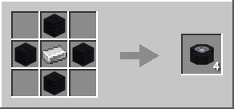
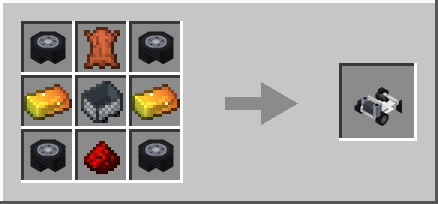
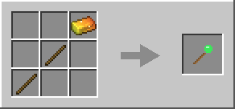
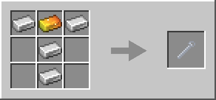

# Craft Team Racing (CTR)

Drive **kart-racing-game karts** through your Minecraft world. Craft a kart from a Power Palm's fruit, build a race track out of ordinary blocks, link it up with a few
nodes and race your friends: powerslides, hops, turbo boosts, boost pads, start boosts, hang time, crates and power-ups.

A NeoForge mod for **Minecraft 1.21.1** (NeoForge 21.1.x, Java 21). Standalone: nothing else is needed, and [Create](#mod-compatibility), Fusion, Jade and others only add to it.

> *Unofficial fan project, not affiliated with or endorsed by Activision, Sony, Naughty Dog or Mojang. It ships no assets from the original game.*
>
> **Please play the original.** The kart handling here is a port of *Crash Team Racing*'s (Naughty Dog, Sony), a wonderful game that deserves to be played. If you enjoy this mod, get a
> legitimate copy of the game through official channels. The optional local-asset tools in this repository only work with a disc you own, and never put any of the original's content in the
> mod or the repository. *Crash Team Racing* is a trademark of its owners.

> **Status: first release, 0.1.0.** Survival, racing and power-ups work and have been played a lot; time trials, battle mode, Sable / Aeronautics support and a guide book are still to come
> ([Status](#status)). Expect rough edges and please report them.

## What you get
**Racing**
- **Karts with an authentic driving model.** Powerslides, hops, boost presses on the red zone of the meter, start boosts, spin-outs, wall slams, hang time, the four engine classes as selectable tunings. Driving runs at 30 Hz on the driver's own client.
- **Smooth driving over Minecraft terrain.** One-block steps, slabs and stairs become ramps; two-block steps and fences are walls. No special road blocks are needed.
- **Boost blocks** (pad, block, slab, stairs, plus a blue **Super Boost** family), with connected textures if Fusion is installed and support for Create's and Copycats+ copycat blocks.
- **A track editor made of blocks and one tool**: Start and Checkpoint nodes, a Track Tool, and a test drive that validates the course, with support for branching paths and shortcuts.
- **Races for you and your friends**: a gathering area, a camera pan over the grid, the four lamps, start rev, laps, positions, a track bar and respawn. Optional Podium nodes add a podium ceremony with confetti, a Viewing Console lets anyone who is not racing watch, and nodes and triggers can give redstone outputs.
- **Crates and power-ups** with an authentic, place-based randomisation: Redstone Surge, Bomb, Rocket, TNT, Potion, Slime Shield, Totem, End Crystal and Clock, each with a stronger *charged* form at 10 Power Fruit.
- **Rule items**: a Rulebook, a Drop Table and a Track Music Sheet decide the rules, the power-ups and the music of a track, as track defaults or per race.

**Open world and survival**
- **Survival crafting**: a full progression from a fresh world. Find Power Palms on beaches, harvest Power Fruit, cook it into Power Juice, smelt Power Ingots, and craft wheels, crates, karts and the rest. Every item has a recipe.
- **Kart upgrades**: Offroad Tires, Soft Bumper, Floater (and the lava-proof Obsidian Floater), Paddle, Jump Spring, Low Gravity Module, paint, tuning profiles.
- **Interacting with the world**: outside a race, karts bump and hurt mobs, boats, minecarts and players on foot (configurable), and Minecraft's damage reaches karts (an arrow spins one out, fire burns it, an explosion breaks it). See [Karts and other entities](#karts-and-other-entities).

## Quick start
1. Install NeoForge 21.1.x for Minecraft 1.21.1 and put `craftteamracing-<version>.jar` in `mods/`. See [Mod compatibility](#mod-compatibility) for the optional mods that enhance it.
2. **Creative:** open the *Craft Team Racing* tab, take a **Kart**, right-click the ground to place it and right-click it to get in. Drive: see [Controls](#controls). Sneak to get out.
3. **Survival:** follow [From a palm to a kart](#from-a-palm-to-a-kart-survival).
4. Build and race a track: see [Building a race track](#building-a-race-track).

## From a palm to a kart (survival)
```
Power Palm --> Power Fruit --cook--> Power Juice
Power Juice + Raw Iron --> 2 Raw Power Ore --smelt--> Power Ingot
```
1. **Find a Power Palm** on a beach, beside water in a desert or a jungle, or at a desert **oasis** (a small pond with palms and sugar cane), or plant its sapling (it also grows in dirt). Its fronds drop Power Fruit and saplings, and fruit hangs in clusters under the fronds that grow back over time. Power Fruit is food.
2. **Cook Power Juice** from the fruit in a furnace, smoker or campfire. It is a drink.
3. **Make Power Ingots.** Power Juice and a Raw Iron make two Raw Power Ore; smelt them in a furnace or blast furnace.
4. **Craft the basics:**

| Wheel (makes 4) | Kart |
|:---:|:---:|
|  |  |
| **Track Tool** | **Wrench** |
|  |  |

Every recipe also shows in a recipe viewer such as JEI or REI, and all of them are drawn out in [docs/ITEMS.md](docs/ITEMS.md).

Worldgen of palms can be switched off in the server config (`worldgen`). Optional built-in resource packs (Options > Resource Packs): *Fluffy Palm Fronds* (fluffy leaves), *Farm & Charm Sacks* (active only with that mod) and *Still Boost Pad Arrows*.

## Blocks and items
A summary of what is in the mod. Everything is in the *Craft Team Racing* creative tab and has a survival recipe; the recipes, drawn as crafting grids, are in [docs/ITEMS.md](docs/ITEMS.md).

| Item | What it does |
|---|---|
| **Kart** | A rideable kart. Right-click the ground to place it, right-click it to get in, sneak to get out (not in a race). Dyes paint the frame; with one leather also the seat; a water cauldron washes it off. Picking it up with the Wrench keeps its upgrades, paint and tuning. |
| **Wrench** | Right-click a kart for its screen (can it start races, its upgrades, its tuning). Right-click a power-up crate spot to choose what it gives. Crouch and right-click any pickup spot to switch whether a race manages it or only redstone does. Crouch and hit a kart to pick it up. |
| **Boost Pad / Block / Slab / Stairs** | A turbo boost whichever way you drive over it; the arrow is a marker. The pad has no collision. An empty-hand click turns the arrow. |
| **Super Boost Pad / Block / Slab / Stairs** | An opt-in blue boost family: a longer, stronger boost with the blue flame. |
| **Track Tool** | Links nodes, resizes their boxes, opens the Start Node's menu. |
| **Kart Barrier** | An invisible wall that stops karts only, and only during a race. Shown as a ghost while you hold a track building item. |
| **Start Node**, **Checkpoint Node** | Invisible markers that make the track. See [Building a race track](#building-a-race-track). |
| **Podium Nodes** (1st, 2nd, 3rd) | Optional: where the winners stand for the podium ceremony. |
| **Viewing Console** | Optional: a full block with a monitor that lets a player who is not racing watch the race of the Start Node it is hooked up to. See [Watching a race](#8-watching-a-race-optional). |
| **Power Fruit Spot**, **Power Fruit Crate Spot**, **Power-up Crate Spot** | Where fruit, fruit crates and power-up crates appear in a race. Invisible unless you hold something to edit them. |
| **Trigger Crate Spot**, **Redstone Linking Node** | A "!" crate that gives a redstone signal when it is broken, and the wireless far end of that signal. |
| **Rulebook**, **Drop Table**, **Track Music Sheet** | Rules, power-up drops and music of a track. Right-click a Start Node to apply. |
| **Offroad Tires**, **Soft Bumper**, **Floater**, **Obsidian Floater**, **Paddle**, **Snow Skis**, **Jump Spring**, **Low Gravity Module** | [Kart upgrades](docs/UPGRADES.md): use one on a kart to install it, then switch it on in the kart's screen. In a race the rules decide. |
| **Power Fruit, Juice, Ingot, Nugget, Block of Power, Raw Power Ore, Bag of Power Fruit** | The survival chain. |
| **Power Palm wood set** | Logs, wood, stripped, planks, stairs, slabs, fence, gate, door, trapdoor, button, pressure plate, fronds, sapling. |
| **Wheel, Item Crate, Fruit Crate** (and planked variants) | Building blocks and ingredients. |

### Fruit, crates and power-ups
Spots are small marker blocks, invisible unless you hold something to edit them.
- **In a race:** a pickup appears at a spot while a race is on a track near it (within 96 blocks of the track, configurable) and is gone when the race ends.
- **With redstone (optional):** a redstone signal switches a spot on, so its pickup appears (and respawns) without any race for as long as the signal lasts. Spots with and without redstone can share a track.
- **Power Fruit count and held power-up** belong to the kart; every race starts with nothing.
- **Charged:** at 10 Power Fruit a kart is **charged** and its power-ups come in their stronger forms.
- **Crates spin.** In the original a crate keeps a fixed orientation. Here crates spin and hover, which looks more alive, and the spots can be placed freely, in mid-air or against a block. This is a deliberate difference.

| Power-up | What it does here |
|---|---|
| **Redstone Surge** | A speed burst (bigger when charged). |
| **TNT** | Dropped behind you. The first other kart to touch it gets it on its head and is blasted three seconds later; **jump repeatedly** to throw it off. Charged: a **Creeper** crate that explodes at the first touch. |
| **Potion** | Dropped behind, or thrown in an arc when you hold forward. A kart that touches it spins out and **loses Power Fruit**. Charged: a red one that also puts a **rain cloud** over the kart for a few seconds, which **slows it down** (or swaps the power-up it holds). |
| **Bomb** | Rolls ahead, or backwards when you hold back; explodes on a kart or an obstacle, and use again to set it off early. Charged: a bigger blast. |
| **Rocket** | Flies along the nose and homes in on the closest kart ahead; faster and sharper when charged. |
| **Slime Shield** | A bubble that takes one hit; throw it forward with the use key. Charged: a blue one that lasts until it is hit. |
| **Totem** | A few seconds of invincibility and a speed bonus; any kart you touch is blasted. Its look (light or dark) is a setting on the kart. |
| **End Crystal** | Follows the course after the kart in first place; every kart it touches is blasted. Charged: it goes through every kart ahead of you. |
| **Clock** | Freezes, then slows, every other kart. |

How many of a power-up a crate gives is set per crate spot (Wrench) or in the Drop Table. Placed weapons follow the original's mine pool (ten at a time, cleared when a race ends; any left on the track are also cleared before the lights, whoever placed them). What each one does and where it differs from the original is in [docs/POWERUPS.md](docs/POWERUPS.md).

## The race screen
The HUD has the feel of the original's, adapted to sit with Minecraft's own interface instead of copying its layout: the clock and lap times, the first four racers, your place in big digits, the start lamps, the held power-up with the Power Fruit count, and the driving meters (speed dial, powerslide box, hang-time bar).
Additions of the mod: a **lap counter**, a **track bar** above the timers showing every racer's head along one lap, and **WRONG WAY** and **CHECKPOINT SKIPPED** warnings (each can be switched off in the client config).

## Controls
All of these can be rebound under Options > Controls > Craft Team Racing (the movement keys are Minecraft's own).

| Action | Default | Notes |
|---|---|---|
| Accelerate / steer / reverse | `W` / `A` `D` / `S` | |
| Brake | `X` | With `W` held, a power-brake. |
| Hop / powerslide / boost press | `Space` | Hop; land with it held and steering to powerslide; tap it in the red zone of the meter to boost. |
| Second shoulder button | `C` | The same as `Space`; either one hops and boosts. |
| Use the held power-up | `V` | The alternate way of firing is its own key (`Q` by default; the drop key does nothing in a kart): it throws a Potion forward and rolls a Bomb backwards. Use again to set a Bomb off early or throw a Slime Shield. |
| Respawn at last checkpoint | `R` | Race only, with a short cooldown. |
| Leave a race | hold `Backspace` | Two seconds, race only. |
| Get out of the kart | `Shift` | Not during a race. |
| Rev on the grid | hold `W` | Until the lights go out. |

## Karts and other entities
- **Kart against kart** is the original's bump: each kart is a sphere, overlapping spheres push apart, the heavier is bounced less, nothing is damaged.
- **Karts and everything else** (mobs, boats, minecarts, players on foot) is the mod's own system and is **on by default**, because it is part of playing in a survival world. The kart bounces, the thing it hit is thrown, and at speed it is hurt (about a heart for every 2 blocks/s over a walking pace; their own pets are spared; players on foot only where PvP is on).
  Server config, section `entities`: `contact`, `damage`, `damagePlayers`, `damageScale`.
- **Minecraft's damage reaching karts** differs between the open world and a race (details and the full table in [docs/DAMAGE.md](docs/DAMAGE.md)):
  - *Open world:* an arrow or other hit spins the kart out, fire burns it, and an explosion or lava breaks it into its item. Only a crouching Wrench hit picks a kart up.
  - *In a race:* the kart reacts too (spin, burn, blast tumble) but is never broken, and by default the driver loses no health and no hunger. The Rulebook can turn driver damage and hunger on. Rules for which damage sources count in a race are planned.
- **Water and lava** slow a kart unless it has a Floater.

## How the kart drives over blocks
The kart physics expects smooth ground and Minecraft is made of blocks, so the mod turns the blocks around the kart into a smooth surface many times a second, and the unchanged physics drives on that:
a one-block step is a 45 degree ramp, slabs and stairs are gentle ramps, a staircase of blocks becomes a slope, and drive off the top of one fast enough and you jump (the airtime builds the **hang-time boost**).
Two-block steps, fences, walls and ceilings are walls. **Surfaces come from block tags** (`craftteamracing:surface/...`): dirt, grass, sand and gravel are slow off-road, ice and snow are slippery, mud and soul sand are slow,
everything else is full-speed asphalt, and a data pack can change any of this. The long version is in [docs/TERRAIN.md](docs/TERRAIN.md).

## Building a race track
A track is a loop of **nodes** that you place and link. The nodes are invisible markers; the track is whatever you build around them with ordinary blocks, so the track's walls and shape decide where players can go.
Who may edit tracks is a server setting (`trackEditing`: creative players and operators by default).

### 1. Build the road
Build the course out of normal blocks first. One-block steps, slabs and stairs are ramps; two-block steps, fences and walls are walls. Put **boost blocks** where you want boosts and
build walls where players should not leave the track.

### 2. Place the nodes
- Put a **Start Node** at the start line, on the road surface, **facing the direction of travel**: the grid is laid out behind it. Nodes face the way you look; holding a node shows a preview with all 16 directions.
- Put **Checkpoint Nodes** along the course, roughly one per corner or every 20-40 blocks.
- Placing a node onto an existing node replaces it and keeps its links; breaking one (holding a node item or the tool) removes it and its links.

### 3. Size the boxes
Every node is a **box** (a wireframe while you hold the tool): a kart passes a node by touching its box, from any direction. The default is generous (24 wide, 6 deep, 8 above and 3 below).
With the Track Tool, point at a side of a box: **right-click extends it by one block, left-click retracts it**. Cover the whole width of the road, and as tall as any jump needs.

### 4. Link the nodes
With the Track Tool, right-click a node to select it, then the next node to link them (again to unlink). Walk round the course in order: Start, checkpoint, ..., back to the Start.
A node linked to several others makes a **branch**: link a shortcut or alternative route between two main-path nodes. Links can be up to 192 blocks long and a track has one Start node. Sneak + right-click in the air clears the selection.

### 5. Test drive
Sneak + right-click the **Start Node** with the tool for its menu and choose *Start test drive*. Drive a kart round the course through every box in order: the boxes you can reach next glow cyan and a gold line shows the recorded **main path**.
Passing the start again closes the lap; then drive the branches back to the main path. The track is **valid** once every node is driven. The menu also sets the number of laps and can re-record the main lap.

In a race, the rings next to a fork or a merge count in either order: after the node where a branch leaves, either the branch's first ring or the next main ring counts, and you can back out of a branch onto the main path (or the other way round) without driving back to the fork, because either route covers the same ground. A merge is a closed case: once all of a shortcut's rings are passed, the main ring before the node it merges into is where your line is, whichever lane you end up nearest.

### 6. Race
Drive a kart into the **gathering area**, a box 16 blocks wide and deep behind the Start Node's line. With the default setting one kart is enough to begin; the 10 second countdown lets others drive in.
Karts are put on the grid in random order and held; **hold the gas to rev while the four lamps count down and let go at the right time for the start boost** (rev into the red zone for a small boost, pump the gas to raise the target for a big one, hold it too long and you get nothing).
Then it is laps, positions and times; `R` takes you back to your last checkpoint. A kart you do not want to start races can be switched off with the Wrench.

### 7. Podium (optional)
A track works without this step. Place **Podium Nodes** (1st, 2nd, 3rd) where the winners should stand, facing the way their karts should face, and hook each one up to the Start Node (Track Tool: click the podium node, then the Start Node).
With all three hooked up the first three finishers are put on their podiums, finished racers are *ethereal* (no collisions, no pickups), confetti and streamers rain over the occupied podiums, everyone else is put back on the grid place they started in and watches the camera sweep over the winners (with a podium node in hand, the camera's paths are drawn: green for the group shot, a red cross where it has no room),
the Start Node and podium nodes are **redstone sources** while active, and after the ceremony the track is closed for 15 seconds before the next race can start.

### 8. Watching a race (optional)
Place a **Viewing Console** anywhere (the monitor faces you as you place it) and hook it up to the Start Node with the Track Tool: select the Start Node, then click the console (click again to unhook).
Right-clicking the console tunes in to that track at any time. You are put in spectator mode, so nothing can hurt or push you, and you take no part in the race; breaking or unhooking the console, or leaving, puts you back in your game mode and where you stood (also after a log out or a crash).
- **No race on:** the camera hangs up and in front of the Start Node and sweeps over the grid, and you see what a racer waiting in the starting area sees: the race starting soon, the cool-down. The wheel zooms.
- **Lamps and race:** you follow a racer, starting with the leader, and see the intro pan over the grid and that racer's screen: clock, lap times, places, track bar, item box, power fruit and speedometer. Left and right click switch to the next and the previous racer, the mouse turns the view round the kart, the wheel zooms. If your racer finishes you move to the one who is now in their place.
- **Podium:** with the podium nodes set up, you watch the same group shot as the racers who are not on the podium.
- **Leaving:** hold sneak for three seconds (a bar fills). Jade's pop-up is hidden while you watch, as it is in a race.
The console is crafted from Power Ingots, Power Nuggets, a glass pane and redstone (see [docs/ITEMS.md](docs/ITEMS.md)).

### 9. Crates, rules, music
Place **Power Fruit Spots**, **Fruit Crate Spots** and **Power-up Crate Spots** along the road (within 96 blocks of the track). The **Wrench** on a power-up crate spot makes it give a particular power-up or a selection.
The **Rulebook** sets which pickups and boost pads exist, the race's pace, driver damage and hunger, and which upgrades count for everyone; the **Drop Table** sets which power-ups crates give; the **Track Music Sheet** the music.
Each is applied by right-clicking the Start Node, as the track's default or for the next race only.

### Pitfalls to avoid
- **Gaps in the boxes.** A kart has to *touch* the next node's box. If the road is wider than the box, or a jump takes the kart more than 8 blocks above (or 3 below) the node, the checkpoint will not count. Widen the box or add a node before and after the jump.
- **A box that covers more than its part of the track** (a hairpin, a parallel lane, a bridge over the track) lets players skip ahead. Keep boxes to the road they belong to.
- **Forgotten nodes.** The track is only valid when every node, branch included, has been test driven. Changing nodes or links later invalidates it; a race cannot start on an invalid track.
- **Unclosed loops.** Link the last node back to the Start. Branches must rejoin the main path at both ends (a branch may rejoin at the Start Node itself).
- **A start line with no room.** Karts are placed on a grid behind the Start Node (two rows of four, 3.8 blocks apart along a row, rows 5 blocks apart, starting 2 blocks behind the line), so flat road about 12 blocks wide must be there.
- **Two Start Nodes close together** overlap their gathering areas. Keep them well apart.
- **Unloaded chunks.** The server follows a kart only in loaded chunks; keep this in mind for very large tracks.
- **Walls you did not mean.** Anything taller than a block and a quarter is a wall. Test drive and see.

### Seeing what the race sees (debug)
`/ctr debug rings` draws every checkpoint box (green passed, yellow the last one, orange the next, grey the rest) and `/ctr debug path` a line to the point on the course you are nearest to, with a line of text about your progress.
Use them when a checkpoint does not count where you expect it to. All the commands, the tuning debug profile for operators and a list of common problems are in [docs/DEBUGGING.md](docs/DEBUGGING.md).

## Mod compatibility
Craft Team Racing is a **standalone mod**: everything above works without any other mod. These are optional.

| Mod | State | What you get |
|---|---|---|
| [**Fusion**](https://github.com/SuperMartijn642/Fusion) | Works | **Connected textures** for boost blocks. |
| [**Create**](https://github.com/Creators-of-Create/Create) | Works | **Copycat blocks** take on the block they copy: a copycat of a boost block boosts, a copycat of ice is slippery. |
| **Copycats+** | Works | The same for its many shapes. |
| **Jade** | Works | Its pop-up is hidden while you race (setting `hideJadeInRace`). |
| **Farm & Charm** | Works | The Bag of Power Fruit uses its sack look (built-in resource pack). |
| **Every Compat** | Works | The Power Palm is picked up as a wood type, so its furniture and wood-based blocks are generated. |
| **Harvest with Ease** | Supported, untested | Fruit clusters use an `age` property (1 to 4) so it can harvest them. Add `craftteamracing:power_fruit_cluster` to the `crops` list in its config (`harvest_with_ease-common.toml`). Right-click harvesting of a full cluster also works without it. |
| [**Sable**](https://github.com/ryanhcode/sable) | Planned | Karts driving on sub-levels. Declared optional; never required, never bundled. |
| **Create Aeronautics** | Planned | Karts on and around airships and contraptions, through Sable. |
| **Xaero's Minimap / World Map** | Planned | The track and the racers on the map. |
| [**Open Parties and Claims**](https://github.com/thexaero/open-parties-and-claims) | Planned | Track building that respects claims. |

## Configuration
- **Server** (`craftteamracing-server.toml` in the world's `serverconfig` folder): `trackEditing`, `raceMinRacers`, `pickupTrackRadius`, `keepCourseLoaded`, `keepWeaponsLoaded`, `speedScale`, `shrinkJumps`, `weaponSpeedScale`, `disabledTuningProfiles`, `entities` (`contact`, `damage`, `damagePlayers`, `damageScale`), `worldgen` (`powerPalms`, `powerPalmsPerChunk`, `oases`, `oasisRarity`).
- **Client** (`craftteamracing-client.toml` in `config`): sounds, animated boost pads, podium camera, wrong-way and skipped-checkpoint warnings, motion blur, the idle start grid, Jade hiding, the shield's dark layer. All have an in-game config screen (Mods > Craft Team Racing > Config).
- **Data packs**: kart tuning profiles (`data/<namespace>/craftteamracing/kart_tuning/`, [docs/KART_TUNING.md](docs/KART_TUNING.md)), surfaces and boost pads (block tags), recipes and loot as usual.

## Status
| | |
|---|---|
| **Works today** | Everything described above. |
| **Planned** | Time trials and ghosts. Battle mode (and its Super Engine and Invisibility power-ups). A ready check before a race. Kart looks and parts. Sable / Aeronautics support. Claims support for building tracks on a server. Xaero map integration. Data pack power-ups. Advancements and an in-game guide book. |

The plan is in [docs/ROADMAP.md](docs/ROADMAP.md).

## Original game assets (optional, local only)
The mod ships **only original, synthesised placeholder sounds and original models and textures**. It never ships anything from the original game.
If you own *Crash Team Racing*, the supplied tools can build **local resource packs** from your own disc that bring the original's sounds, music and artwork and its own names (the packs rename the Power Fruit, the Totem's light and dark and the music's levels back to the original's).
**Nothing from the disc is ever committed or put into the mod jar, and the resulting packs must not be shared.**

- **The easy way: the `asset-extractor` folder.** Copy it into your Minecraft instance folder (next to `mods\` and `resourcepacks\`), put your disc image (`.bin`, `.iso` or `.cue`) into its `iso` folder and run `extract.bat`. It identifies the game from the disc itself, runs the extractors (sounds, music, textures), and installs the packs into the instance's `resourcepacks` folder; enable them in Options > Resource Packs. Needs Python 3.
  `extract.bat --list` says what is in `iso`; `--only sounds,music` runs some steps. See `asset-extractor/README.txt`.
- **From a checkout** the separate `scripts/extract-ctr-sounds.bat`, `scripts/extract-ctr-textures.bat` (two packs: Minecraft-sized and original-sized) and `scripts/extract-ctr-music.bat` (jingles and the level music, rendered offline from the game's sequences, see [docs/MUSIC.md](docs/MUSIC.md)) do the same.
- `scripts/browse-ctr-assets.bat` writes a local web page to look through what is on your disc, and `tools/ctr_disc/export_ctr_mesh.py` exports models as OBJ files for Blender.

## Building from source
Java 21 is needed.
```
gradlew build
```
makes `build/libs/craftteamracing-<version>.jar`. `gradlew test` runs the unit tests (physics, terrain, tracks, upgrades). `build-and-install.bat` also runs the generators in `tools/` (Python 3 with Pillow and numpy) and copies the jar into test instances; edit the paths in `build-and-install.ps1`.

## How it is being made (please read)
This project is built by one developer **together with Claude** (Anthropic's AI model, through Claude Code), as *curated vibe coding*: the developer decides what the mod should be and how it should feel and plays every change in the game; Claude writes much of the code, tools and documentation.
- The code is AI-assisted. It is tested (unit tests for the physics, terrain and track logic) and played a lot, but it has not had a traditional human code review, and bugs are to be expected.
- Where the original game's behaviour matters, the numbers are checked against the decompilation rather than remembered; what is *not* verified is marked as such in [docs/PHYSICS_PORT.md](docs/PHYSICS_PORT.md).
- **Playtesting:** features are vetted through closed, informal playtesting. Progress is streamed and demonstrated live to a small group of friends, who try each feature, ask questions and give feedback along the way. This is community playtesting, not a formal peer review.
- The docs split into guides that describe what is implemented, and design notes that record how and why it was planned; [docs/README.md](docs/README.md) says which is which.

## Inspiration and references
The project is inspired by [**World of Kartcraft**](https://github.com/duxanlol/world-of-kartcraft) (the original's physics as a standalone game in Rust). The physics here is ported function by function from the
[**ctr-native**](https://github.com/CTR-tools/ctr-native) decompilation of the PS1 game and cross-checked against World of Kartcraft's Rust port. Everything else, the Minecraft side (terrain, blocks, entities, networking, tracks, races, survival), is **built from the ground up as an original mod**.

The rule for behaviour: **the default is what the PS1 game does**, as read from the decompilation. Anything beyond that (a Super Boost family, upgrades, tunings) is an opt-in extension: a different block, an item, a data pack entry or a setting. The exception is interaction with Minecraft's own entities, which is on by default.

## Contributing and project rules
Models are made in Blockbench first (`blockbench/`) and mesh models in Blender (`blender/`); the generators in `tools/` build the game files from them. Textures are drawn by the art scripts, which also write them as layered Krita files (`krita/`), templates for anyone who wants to make their own art. The working rules are in [CLAUDE.md](CLAUDE.md); the guides and the design record are in [docs/](docs/).
Bug reports and ideas are welcome as issues.

## License and credits
**GPL-3.0-or-later**, see [LICENSE](LICENSE). The physics is a port of GPL-3.0 code, which is why the whole mod is GPL.
- [ctr-native](https://github.com/CTR-tools/ctr-native) (GPL-3.0): the decompiled game the physics, boosts and start rev are ported from.
- [world-of-kartcraft](https://github.com/duxanlol/world-of-kartcraft) (GPL-3.0): the inspiration for this project, and a Rust port of the same physics used as a cross-check.
- Files that come from the NeoForge MDK template (build scripts, Gradle wrapper) keep their own license, see [TEMPLATE_LICENSE.txt](TEMPLATE_LICENSE.txt).

## Known issues
- **Shader packs and the 3D models (Iris + Complementary tested).** The Potion's flask and the other mesh models are exported with smooth vertex normals and the game receives them intact, but under an Iris shader pack the shader's lighting of these entity models comes out faceted, one flat tone per triangle.
  We could not find the cause; it is treated as a limitation of the current Iris and shader pack pipeline for these models.
