# Items and recipes

Every item of the mod, what it does and how to craft it, grouped as in the creative tab. The pictures are drawn from the recipe files by `tools/make_recipe_grids.py`, so they match the game. Every recipe also shows in a recipe viewer such as JEI or REI.
Shapeless recipes (no fixed pattern) have their ingredients laid out from the top left. For the survival progression as a whole see [SURVIVAL.md](SURVIVAL.md); for kart upgrades in depth, [UPGRADES.md](UPGRADES.md).

**Contents:** [Basics](#basics) · [Power Fruit chain](#the-power-fruit-chain) · [Boost blocks](#boost-blocks) · [Track building](#track-building) · [Crates and spots](#crates-and-spots) · [Rule items](#rule-items) · [Kart upgrades](#kart-upgrades) · [Power Palm wood set](#power-palm-wood-set)

## Basics
| Item | Recipe | What it does |
|---|---|---|
| **Wheel** | 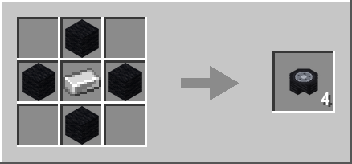 | Four wheels from one craft. They are the building block of the Kart and the Offroad Tires. Placed as a block on the ground; right-click with another wheel to add up to four. |
| **Kart** | 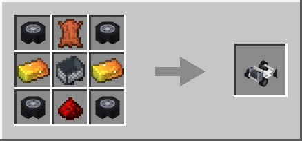 | The rideable kart. Right-click the ground to place it, right-click it to get in, sneak to get out (not in a race). Dyes paint it, see below. |
| **Wrench** | 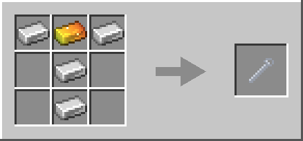 | Right-click a kart for its screen (can it start races, its upgrades, its tuning and Totem look); right-click a power-up crate spot to choose what it gives; crouch and hit a kart to pick it up with its upgrades and paint. |
| **Track Tool** | 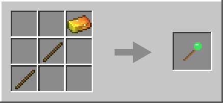 | Links nodes, resizes their boxes, and opens the Start Node menu with the test drive. See [Building a race track](../README.md#building-a-race-track). |

**Painting a kart.** Put a Kart and one or more dyes in the crafting grid to paint its **frame**; add one leather as well to paint the **seat**. Dyes mix with the colour already there, as with leather armour. A kart item is washed clean by right-clicking a water cauldron with it. (A special recipe, so there is no fixed picture.)

## The Power Fruit chain
Power Palms grow on beaches (see [SURVIVAL.md](SURVIVAL.md)); their fronds drop **Power Fruit** and **saplings**, which are not crafted. Fruit also hangs in clusters under the fronds.

| Item | Recipe | What it does |
|---|---|---|
| **Power Juice** |  | **Cook** a Power Fruit in a furnace. Juice is a drink and returns the glass bottle. |
| **Power Juice (smoker)** |  | The same in a smoker, twice as fast. A blast furnace does not cook food. |
| **Power Juice (campfire)** | 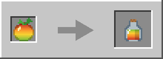 | The same on a campfire. |
| **Raw Power Ore** |  | Shapeless. One Power Juice and a Raw Iron make **two**. |
| **Power Ingot (smelted)** | 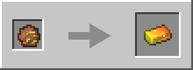 | Smelt Raw Power Ore in a furnace. |
| **Power Ingot (blasted)** |  | Or in a blast furnace, faster. |
| **Power Ingot (nuggets)** |  | Nine Power Nuggets. |
| **Power Nugget** |  | Nine from one ingot. |
| **Block of Power** | 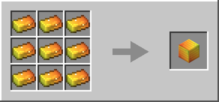 | Nine ingots. A decorative block that gives off a little light. |
| **Power Ingot (from a block)** | 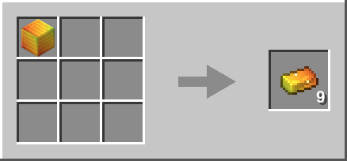 | Nine ingots back from one Block of Power. |
| **Bag of Power Fruit** | 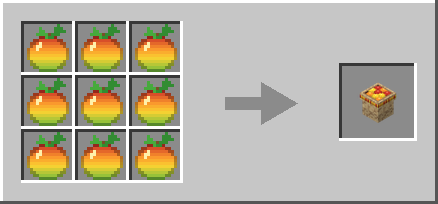 | Nine fruit in a sack that stands on the ground. With Farm & Charm installed it uses that mod's sack look. |
| **Power Fruit (from a bag)** |  | Nine fruit back from the bag. |

## Boost blocks
A turbo boost whichever way you drive over them. The pad has no collision, and an empty-hand click turns its arrow. The **Super Boost** family is an opt-in blue variant with a longer, stronger boost.

| Item | Recipe | What it does |
|---|---|---|
| **Boost Pad** | 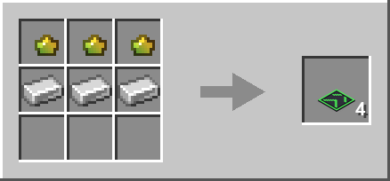 | Four pads from three nuggets over three iron ingots. |
| **Boost Block** | 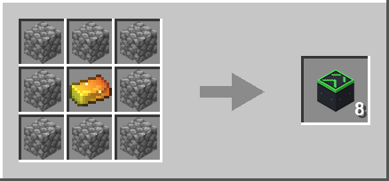 | Eight blocks from cobblestone round an ingot. |
| **Boost Slab** |  | Six slabs. |
| **Boost Stairs** | 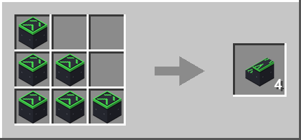 | Four stairs. |
| **Super Boost Pad** |  | Shapeless: a Boost Pad and Lapis Lazuli. |
| **Super Boost Block** |  | A Boost Block and Lapis Lazuli. |
| **Super Boost Slab** | 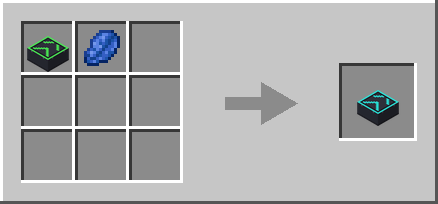 | A Boost Slab and Lapis Lazuli. |
| **Super Boost Stairs** |  | Boost Stairs and Lapis Lazuli. |

## Track building
Invisible markers that make a track; you see them while you hold a node, the Track Tool or the Wrench.

| Item | Recipe | What it does |
|---|---|---|
| **Checkpoint Node** | 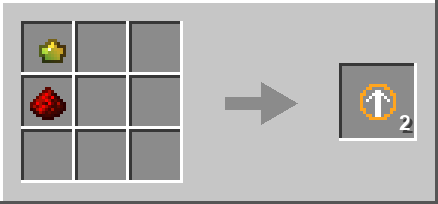 | Two nodes from a nugget over redstone. A kart passes it by touching its box, from any direction. |
| **Start Node** | 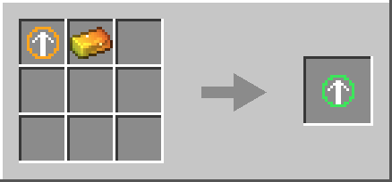 | Shapeless: a Checkpoint Node and a Power Ingot. One per track; the grid and gathering area are laid out behind it. Right-click it with a rule item to apply that. |
| **Podium 1 Node** | 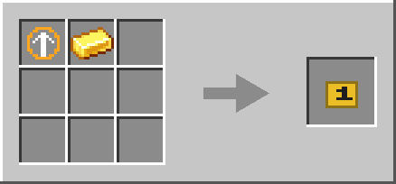 | Optional. A Checkpoint Node and a gold ingot. Where the winner stands in the podium ceremony. |
| **Podium 2 Node** | 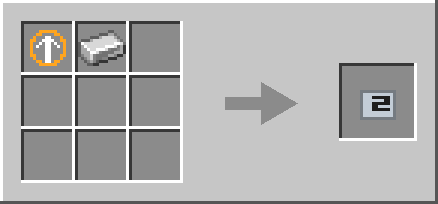 | Optional. With an iron ingot: second place. |
| **Podium 3 Node** |  | Optional. With a copper ingot: third place. |
| **Redstone Linking Node** |  | A small visible block that gives a redstone signal while any Trigger Crate Spot linked to it does. Link with the Wrench. |

## Crates and spots
Spots are small markers: a pickup appears there while a race is on a track near it, or when a redstone signal arms it. The crates are also plain building blocks.

| Item | Recipe | What it does |
|---|---|---|
| **Item Crate** |  | Two crates, marked on every side as a power-up crate is. An ingredient, and a block. |
| **Fruit Crate** | 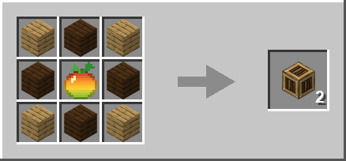 | Two crates; an ingredient of the fruit crate spot. |
| **Planked crates** |  | Cut an Item or Fruit Crate at the **stonecutter** to get its planked look, and back. The Item Crate also has a random-faced variant. |
| **Power Fruit Spot** | 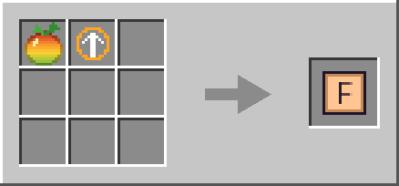 | Shapeless: a Power Fruit and a Checkpoint Node. A fruit appears here in a race. |
| **Power Fruit Crate Spot** | 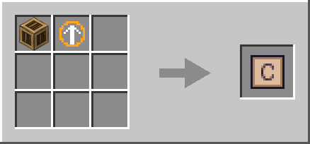 | A Fruit Crate and a Checkpoint Node. A crate of 5 to 8 fruit. |
| **Power-up Crate Spot** |  | An Item Crate and a Checkpoint Node. Gives a power-up by the original's place-based roulette, or what you set with the Wrench (one or several power-ups, each with a quantity). Crouch and right-click a placed spot with another spot item to copy its setting onto the whole stack. |
| **Power-up Crate Spot (cleared)** | 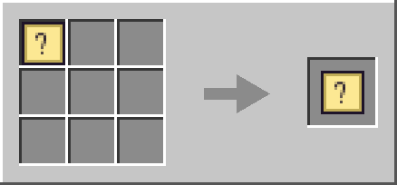 | A spot item alone in the grid clears the setting it carries. |
| **Trigger Crate Spot** | 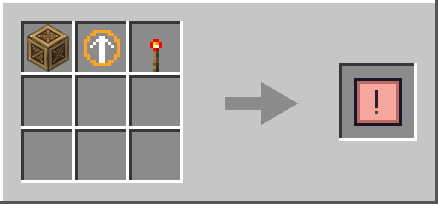 | An Item Crate, a Checkpoint Node and a redstone torch. A "!" crate that gives a redstone signal when it is broken; set its respawn, signal length and uses with the Wrench. |

## Rule items
Right-click in the air to set one up in its screen, then right-click a Start Node to apply it: as the track's default (needs permission to edit tracks), or for the next race only. A rule item cannot be applied while a race is on the track.

| Item | Recipe | What it does |
|---|---|---|
| **Rulebook** |  | Shapeless: a book, a nugget and redstone. Toggles for power fruit, fruit crates, power-up crates, boost pads, driver damage and hunger, offroad for all, soft bumper for all and the floater, spring and low-gravity rules; a top-speed cap. |
| **Drop Table** |  | A book, a nugget and an Item Crate. A grid of power-ups with a weight each, or the classic roulette. |
| **Track Music Sheet** | 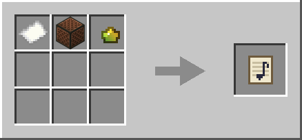 | Paper, a note block and a nugget. Picks the music a track plays and the title shown. |

## Kart upgrades
Use one on a kart (right-click it) to install it; its switch then unlocks in the kart's screen. In a race the track's rules decide, not the kart's switches. See [UPGRADES.md](UPGRADES.md).

| Item | Recipe | What it does |
|---|---|---|
| **Offroad Tires** |  | Dirt, grass, snow and mud drive like asphalt. Ice and water are left as they are. |
| **Soft Bumper** |  | The kart does no collision damage to the entities it bumps, but still bounces and throws them. |
| **Floater** |  | The kart floats on water, which slows it as water does. |
| **Obsidian Floater** | 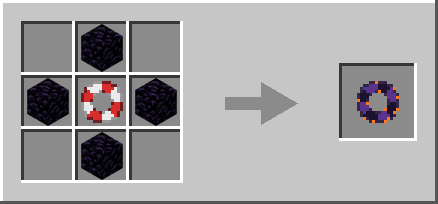 | Replaces the Floater, floats on lava too and protects the rider from lava, fire and hot floors. |
| **Paddle** | 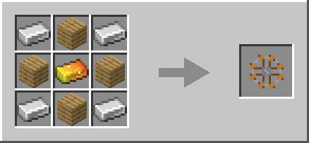 | With a Floater, the kart drives on the water's surface at full speed. |
| **Jump Spring** | 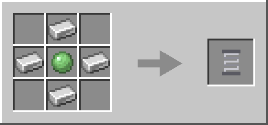 | A double jump: a second press of the jump key in the air gives a high jump. Strength is a slider in the kart's screen. |
| **Low Gravity Module** |  | Reduces gravity in the air only. A slider in the kart's screen. |

## Power Palm wood set
The Power Palm's logs, wood, stripped variants, planks, stairs, slabs, fence, gate, door, trapdoor, button and pressure plate, with the vanilla recipes, plus fronds and a sapling (found, not crafted). Planks burn as planks do.

| Item | Recipe | What it does |
|---|---|---|
| **Power Palm Planks** |  | Four planks from a log. |
| **Power Palm Wood** | 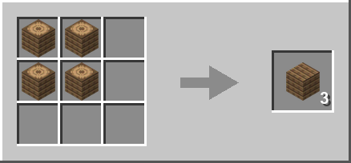 | Three wood (bark on all sides) from four logs. Stripped wood the same, from stripped logs. |
| **Stairs** | 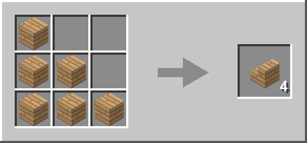 | Four. |
| **Slab** | 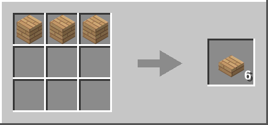 | Six. |
| **Fence** | 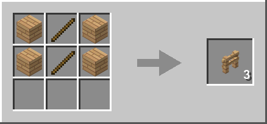 | Three. |
| **Fence Gate** |  | One. |
| **Door** | 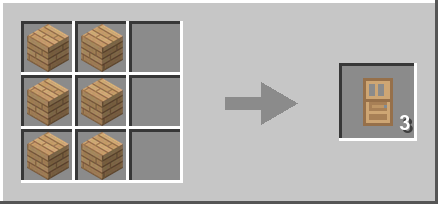 | Three. |
| **Trapdoor** | 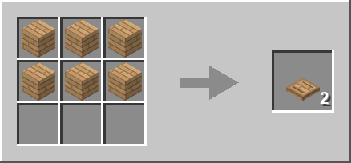 | Two. |
| **Button** | 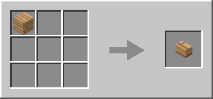 | One. |
| **Pressure Plate** | 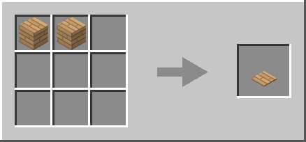 | One. |
