# Items and recipes

Every item of the mod, what it does and how to craft it, grouped as in the creative tab. The pictures are drawn from the recipe files by `tools/make_recipe_grids.py`, so they match the game. Every recipe also shows in a recipe viewer such as JEI or REI.
Shapeless recipes (no fixed pattern) have their ingredients laid out from the top left. For the survival progression as a whole see [SURVIVAL.md](SURVIVAL.md); for kart upgrades in depth, [UPGRADES.md](UPGRADES.md).

**Contents:** [Basics](#basics) · [Power Fruit chain](#the-power-fruit-chain) · [Boost blocks](#boost-blocks) · [Track building](#track-building) · [Crates and spots](#crates-and-spots) · [Rule items](#rule-items) · [Kart upgrades](#kart-upgrades) · [Power Palm wood set](#power-palm-wood-set)

## Basics
**Wheel**: Four wheels from one craft. They are the building block of the Kart and the Offroad Tires. Placed as a block on the ground; right-click with another wheel to add up to four.

**Kart**: The rideable kart. Right-click the ground to place it, right-click it to get in, sneak to get out (not in a race). Dyes paint it, see below.

**Wrench**: Right-click a kart for its screen (can it start races, its upgrades, its tuning and Totem look); right-click a power-up crate spot to choose what it gives; crouch and hit a kart to pick it up with its upgrades and paint.

**Track Tool**: Links nodes, resizes their boxes, and opens the Start Node menu with the test drive. See [Building a race track](../README.md#building-a-race-track).

**Painting a kart.** Put a Kart and one or more dyes in the crafting grid to paint its **frame**; add one leather as well to paint the **seat**. Dyes mix with the colour already there, as with leather armour. A kart item is washed clean by right-clicking a water cauldron with it. (A special recipe, so there is no fixed picture.)

## The Power Fruit chain
Power Palms grow on beaches (see [SURVIVAL.md](SURVIVAL.md)); their fronds drop **Power Fruit** and **saplings**, which are not crafted. Fruit also hangs in clusters under the fronds.

**Power Juice**: A **smoking** recipe: cook a Power Fruit in a smoker. A furnace or a campfire works too, only slower. Juice is a drink and returns the glass bottle.

**Raw Power Ore**: Shapeless. One Power Juice and a Raw Iron make **two**.

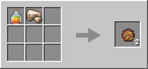

**Power Ingot**: Smelt Raw Power Ore in a furnace, or faster in a blast furnace. The ingredient of the kart, the tools, boost blocks and Start Nodes.

**Power Ingot (from nuggets)**

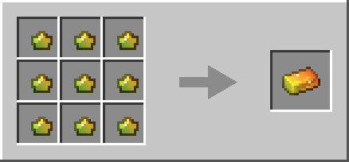

**Power Nugget**: A small form of the ingot, used in boost pads, nodes, crates and the rule items.

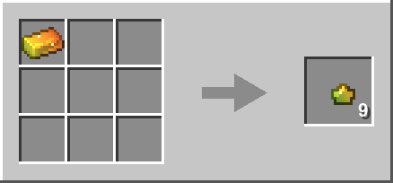

**Block of Power**: Nine ingots. A decorative block that gives off a little light.

**Power Ingot (from a block)**

**Bag of Power Fruit**: Nine fruit in a sack that stands on the ground. With Farm & Charm installed it uses that mod's sack look.

**Power Fruit (from a bag)**

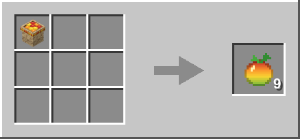

## Boost blocks
A turbo boost whichever way you drive over them. The pad has no collision, and an empty-hand click turns its arrow. The **Super Boost** family is an opt-in blue variant with a longer, stronger boost.

**Boost Pad**: A row of three nuggets over three cobblestone makes four pads. A pad has no collision, and an empty-hand click turns its arrow.

**Boost Block**: Eight blocks from cobblestone round one ingot: a full, solid block that gives a boost.

**Boost Slab**: A half-height boost block, for low edges and ramps.

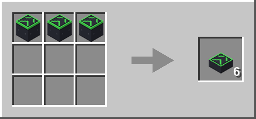

**Boost Stairs**: Stair-shaped boost blocks, driven as a ramp.

**Super Boost Pad**: Shapeless: four Boost Pads and a Lapis Lazuli give four. The blue family boosts longer and harder.

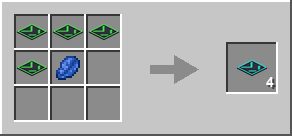

**Super Boost Block**: Shapeless: four Boost Blocks and a Lapis Lazuli give four.

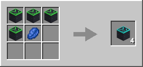

**Super Boost Slab**: Made from Super Boost Blocks, as the regular slab is (three blocks, six slabs). Or upgrade eight Boost Slabs (four blocks) with a Lapis Lazuli, which is the same lapis as the blocks take.

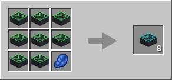

**Super Boost Stairs**: Made from Super Boost Blocks, as the regular stairs are (six blocks, four stairs). Or upgrade three Boost Stairs (four and a half blocks) with a Lapis Lazuli.

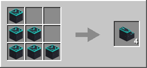

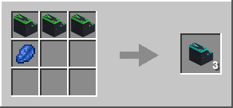

## Track building
Invisible markers that make a track; you see them while you hold a node, the Track Tool or the Wrench.

**Checkpoint Node**: Makes two. A kart passes it by touching its box, from any direction.

**Start Node**: Shapeless: a Checkpoint Node and a Power Ingot. One per track; the grid and gathering area are laid out behind it. Right-click it with a rule item to apply that.

**Podium 1 Node**: Optional. A Checkpoint Node and a gold ingot. Where the winner stands in the podium ceremony.

**Podium 2 Node**: Optional. With an iron ingot: second place.

**Podium 3 Node**: Optional. With a copper ingot: third place.

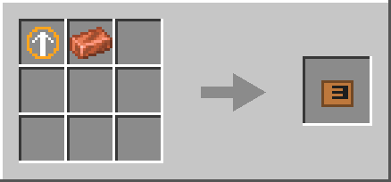

**Kart Barrier**: Makes 16. A block that stops karts and nothing else, and only while the kart is in a race: players, mobs and karts out of a race pass through it. It is invisible, and drawn as a cyan ghost only while you hold a track building item, so you can place and remove a wall of them.

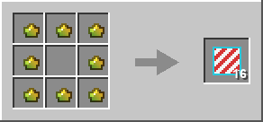

**Redstone Linking Node**: A small visible block that gives a redstone signal while any Trigger Crate Spot linked to it does. Link with the Wrench.

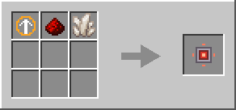

## Crates and spots
Spots are small markers: a pickup appears there while a race is on a track near it, or when a redstone signal arms it. The crates are also plain building blocks.

**Item Crate**: A block marked on every side as a power-up crate is, and the ingredient of the power-up crate spot and the Drop Table.

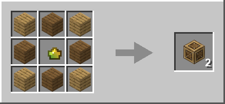

**Fruit Crate**: The fruit crate's block, and the ingredient of the fruit crate spot.

**Planked crates**: Cut an Item or Fruit Crate at the **stonecutter** to get its planked look, and back. The Item Crate also has a random-faced variant.

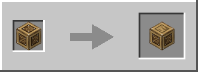

**Power Fruit Spot**: Shapeless: a Power Fruit and a Checkpoint Node. A fruit appears here in a race.

**Power Fruit Crate Spot**: A Fruit Crate and a Checkpoint Node. A crate of 5 to 8 fruit.

**Power-up Crate Spot**: An Item Crate and a Checkpoint Node. Gives a power-up by the original's place-based roulette, or what you set with the Wrench (one or several power-ups, each with a quantity). Crouch and right-click a placed spot with another spot item to copy its setting onto the whole stack.

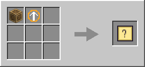

**Power-up Crate Spot (cleared)**: A spot item alone in the grid clears the setting it carries.

**Trigger Crate Spot**: An Item Crate, a Checkpoint Node and a redstone torch. A "!" crate that gives a redstone signal when it is broken; set its respawn, signal length and uses with the Wrench.

## Rule items
Right-click in the air to set one up in its screen, then right-click a Start Node to apply it: as the track's default (needs permission to edit tracks), or for the next race only. A rule item cannot be applied while a race is on the track.

**Rulebook**: Shapeless: a book, a nugget and redstone. Toggles for power fruit, fruit crates, power-up crates, boost pads, driver damage and hunger, offroad for all, soft bumper for all and the floater, spring and low-gravity rules; the race's pace (50 to 100 percent, the server's `speedScale` by default).

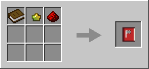

**Drop Table**: A book, a nugget and an Item Crate. A grid of power-ups with a weight each, or the classic roulette.

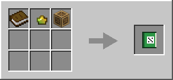

**Track Music Sheet**: Paper, a note block and a nugget. Picks the music a track plays and the title shown.

## Kart upgrades
Use one on a kart (right-click it) to install it; its switch then unlocks in the kart's screen. In a race the track's rules decide, not the kart's switches. See [UPGRADES.md](UPGRADES.md).

**Offroad Tires**: Dirt, grass, snow and mud drive like asphalt. Ice and water are left as they are.

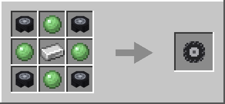

**Soft Bumper**: The kart does no collision damage to the entities it bumps, but still bounces and throws them.

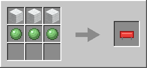

**Floater**: The kart floats on water, which slows it as water does.

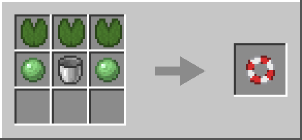

**Obsidian Floater**: Replaces the Floater, floats on lava too and protects the rider from lava, fire and hot floors.

**Paddle**: With a Floater, the kart drives on the water's surface at full speed.

**Snow Skis**: The kart drives on top of powder snow instead of sinking into it. It does not help on ice or other slippery ground.

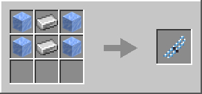

**Jump Spring**: A double jump: a second press of the jump key in the air gives a high jump. Strength is a slider in the kart's screen.

**Low Gravity Module**: Reduces gravity in the air only. A slider in the kart's screen.

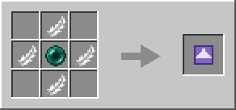

## Power Palm wood set
The Power Palm's logs, wood, stripped variants, planks, stairs, slabs, fence, gate, door, trapdoor, button and pressure plate, with the vanilla recipes, plus fronds and a sapling (found, not crafted). 
**Power Palm Planks**: Planks burn as vanilla planks do.

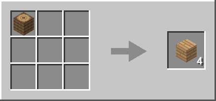

**Power Palm Wood**: Bark on all sides. Stripped wood is made the same way from stripped logs.

**Stairs**

**Slab**

**Fence**

**Fence Gate**

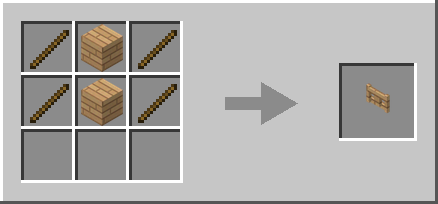

**Door**

**Trapdoor**

**Button**

**Pressure Plate**

