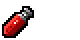
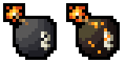
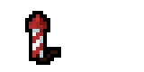
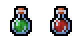
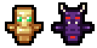
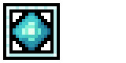

# Power-ups

What each power-up does in the mod today, and where that differs from the original. How they were ported, tuned and re-tuned is in the chronological [POWERUPS_DEVLOG.md](POWERUPS_DEVLOG.md).

## How they work
- **Getting one:** break a power-up crate while holding nothing. The roulette spins for 3 seconds, then the draw is made from a table. By default the table is the original's, which depends on the number of karts and your place in the race (last place gets the strongest items; on lap 1 the last place's table is replaced by the third's). A Drop Table item, or a crate spot set with the Wrench, replaces it (see [ITEMS.md](ITEMS.md)).
- **Quantity:** how many shots a power-up gives is not fixed. The original's table has "stack of three" entries for the Bomb and the Rocket and the default table keeps them. A crate spot can give any power-up in any quantity from 1 to 10, or a random number in a range. Every use takes one shot off the stack, with a short cooldown between shots, and the HUD shows how many are left.
- **Charged:** at **10 Power Fruit** the kart is charged: the effect is stronger, as listed below, and a shining burst sits behind the held power-up in the HUD.
- **Using:** the use key (`V`). Hold forward or back for the throw direction where a power-up has one.
- **Placed weapons** (TNT crate, Potion) share a pool of 10 per race, cleared when the race ends, and before the lights every bomb, missile, potion, TNT crate and warp orb within the pickup radius of the track is removed, whoever threw it (a driver outside the race too); a new one when the pool is full bursts the oldest. Outside a race each player has a pool of 10, and one nobody touches goes away after five minutes.
- **Shields and the Totem:** a Slime Shield or a Totem takes any hostile power-up effect. Damage from the rain cloud, a blast, a spin and the Clock is stopped.

## The power-ups
The icon is what the HUD shows: the normal form, and beside it the charged one where it looks different (the Totem shows its light and dark looks, the Potion its green and red).

### Redstone Surge (the original's Turbo)

A speed burst.

**Charged:** A bigger burst.

### Bomb (the original's Bowling Bomb)

Rolls along the ground in the kart's heading, or backwards at a slower speed when back is held while using it. Follows slopes, climbs a block, explodes on a wall, a kart, a placed weapon or after a long fall, or when you press use again. The blast spins out the karts it reaches (and costs them Power Fruit), and also hurts and throws other entities. Breaks crates it rolls into.

**Charged:** A bigger blast.

### Rocket (the original's Tracking Missile)

Flies along the kart's nose and homes in on the nearest kart ahead of you. A warning shows behind a kart that is being chased. Explodes as the bomb does. It flies unguided with no target, and ends after 20 seconds (the mod's own limit).

**Charged:** Faster and turns sharper.

### TNT (the original's Explosive Crate)

Dropped behind you. The first other kart to touch it gets it on its head and is blasted three seconds later; jumping repeatedly (about 8 to 10 times) throws it off. The one who dropped it is safe for a moment. Looks like a Minecraft TNT block, scaled down.

**Charged:** A **Creeper crate** (the original's Nitro crate): explodes at the first touch.

### Potion (the original's N. Brio's Beaker)

Dropped behind you, or thrown in an arc when forward is held. A kart that touches it spins out and **loses Power Fruit**.

**Charged:** A red potion that also puts a **rain cloud** over the kart for about 8 seconds: it **slows the kart down**, or swaps the power-up it is holding for a new one. A second red potion restarts the cloud.

### Slime Shield (the original's Power Shield)

A bubble that takes one hit, lasts a few seconds, then pops. Use again to throw it forward like a bomb. **Ramming:** a kart with its bubble up that drives into a kart with no bubble and no Totem pops its bubble and blasts that kart, as the original's crash attack does.

**Charged:** Blue: it stays until it is hit.

### Totem (the original's Aku Aku / Uka Uka Mask)

About 8 seconds of invincibility and a big speed bonus that ignores terrain slowing. A kart you touch is blasted, and you drive through other karts. Which Totem (light or dark) is a setting on the kart (Wrench).

**Charged:** 12 seconds.

### End Crystal (the original's Warp Orb)

Flies along the course to the kart in first place and blasts it. From first place it flies straight ahead.

**Charged:** Goes through every kart ahead of you.

### Clock (the original's N. Tropy Clock)

Every other kart spins out and is then slowed for about 8 seconds (the leader is slowed most). They cannot use power-ups meanwhile. Outside a race it reaches karts within 48 blocks. The screen blurs and flashes.

**Charged:** Lasts about 11.5 seconds.

Super Engine and Invisibility exist in the original's **battle mode** only and are not in the mod yet.

## Where the mod differs from the original
Defaults follow the original; these are the deliberate differences.
- **Names and looks:** Minecraft-themed names and stand-in models (the TNT block, the firework rocket, the End Crystal, the totem of undying), so nothing of the original's art ships. A local resource pack made from your own disc can bring the original's pictures and names back (see the README).
- **Crates spin and hover** where the original's keep a fixed orientation, and spots can be placed freely.
- **Open world:** outside a race there is no field and no order, so the End Crystal and Rocket go after the nearest driven kart, and global effects reach 48 blocks around the user.
- **Minecraft entities** are hurt and thrown by explosions, as set by the `entities` server config.
- **Aiming:** the Rocket and Bomb choose a target in a cone ahead (the original tests the screen's rectangle).
- **The Totem and the Slime Shield** pass through other karts with no bounce, for as long as the Totem lasts or the bubble is up. In the original the touch also bounces the two karts apart once, on the frame they meet, and then blasts the other kart, so in play it feels much like passing through; the mod skips the bounce. Only the protected kart gets this: every other kart, mob and boat keeps colliding. When the bubble pops or the Totem ends, the kart it just hit is still being launched and does not collide with it for about 0.8 seconds.
- **Config:** `weaponSpeedScale` scales the speed of thrown weapons.

## Not built
The battle-mode items; the Clock's timer in the HUD; the Totem's echo on its voice and the faster mask song on the last lap; and the animation of the original's Totem beam when a local original-art pack is used (the pack shows its first frame; the mouth animation only exists in the original's Adventure-mode hint masks, not in the power-up). The devlog has the detail.
